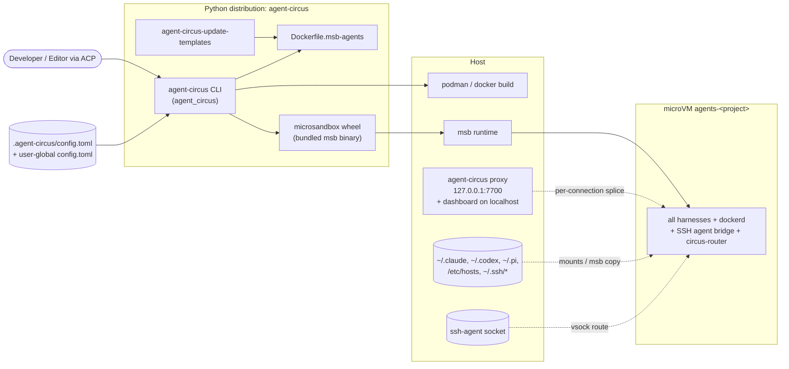
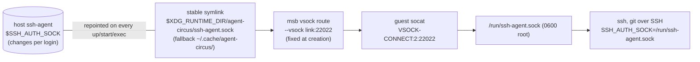
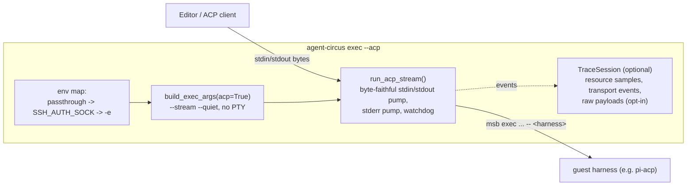

# Architecture

This document describes how the repository is structured, how the tool
works internally, and what we learned while building it. It is written
for developers and coding agents that continue work on the repository.
User-facing documentation lives in `README.md`; migration help for 1.x
users in `MIGRATING.md`. Working rules for agents live in `AGENTS.md`.

Last updated: 2026-11-20.

## 1. Purpose

The repository ships one Python distribution (`agent-circus`, see
`pyproject.toml`) with one CLI that runs AI coding-agent harnesses
(Claude Code, Codex, OpenCode, Pi) in isolation:

| CLI | Isolation | Backend |
|---|---|---|
| `agent-circus` | One microVM per workspace, all harnesses inside | microsandbox (`msb` CLI, bundled in the `microsandbox` wheel) |

A second entry point, `agent-circus-update-templates`, refreshes pinned
tool versions in the bundled msb-agents Dockerfile.

The CLI reads the project config file `.agent-circus/config.toml`, plus
a user-global layer at `$XDG_CONFIG_HOME/agent-circus/config.toml`. It
interprets only the keys it supports and ignores the rest (unsupported
top-level keys are logged as warnings). agent-circus-specific settings
live under `[msb]`.

## 2. Repository layout

```
src/
  agent_circus/          agent-circus CLI (microsandbox based)
    templates/Dockerfile.msb-agents
    templates/circus_router.py   standalone guest HTTP router
  hatch_build.py         build hook: embeds the source commit
tests/                   pytest suite
README.md                user docs
MIGRATING.md             migration guide from agent-circus 1.x
AGENTS.md / CLAUDE.md    agent working rules (CLAUDE.md includes AGENTS.md)
```

The Docker/Podman implementation of 1.x lives on the `v1` branch only.

## 3. High-level component view



## 4. agent-circus

### 4.1 Concepts

- **One sandbox per workspace**, named `agents-<sanitized project dir>`
  (`config.sandbox_name_for_workspace`). All harnesses run in it; the
  harness is chosen per `exec` (`[agent] command`, default `pi`).
- **The guest runs as root.** Guest paths for user config are under
  `/root` (e.g. `/root/.claude`, `/root/.ssh`).
- **msb is driven only through its CLI.** Every msb call goes through
  `msb.MsbInvoker` with argv lists produced by **pure builders**
  (`sandbox.py`, `exec_.py`, `images.py`). Builders are unit-tested without
  msb; the CLI module wires them together.
- **msb binary resolution** (`msb.py`): `[msb] binary` > the binary
  bundled in the `microsandbox` wheel > `msb` on `PATH`. A version drift
  warning applies only to non-bundled binaries; the expected version is
  the installed `microsandbox` distribution (no hard-coded fallback).
- **Image:** `Dockerfile.msb-agents` (Debian slim Node base, uv,
  static dockerd from the dind image, apt packages incl. `openssh-client`
  and `socat`, agents pinned by version). Built on the host with podman
  (default) or docker, exported as tar, imported with `msb load`.
- **Boot path:** always `msb run --detach --init auto` (never
  `msb create`), so s6-overlay becomes PID 1 and starts the services.

### 4.2 Internal view: modules

```mermaid
flowchart TB
    cli["cli.py (Typer app)<br/>version, ps, rm, build, import,<br/>up, stop, start, destroy, exec"]

    subgraph cfg["Configuration"]
        config["config.py<br/>layering, parse_*(), AgentCircusConfig,<br/>effective_mounts, constants"]
        envs["envs.py<br/>env_passthrough, -e parsing, redaction"]
    end

    subgraph builders["Pure argv builders and parsers"]
        sandbox["sandbox.py<br/>run/start/stop/list/inspect/copy/remove,<br/>inspect parsers (ports, disks, binds)"]
        execb["exec_.py<br/>msb exec argv, guest scripts<br/>(trust, codex repair, hosts block,<br/>ssh probe), ACP stream pump"]
        images["images.py<br/>host build + msb load argv"]
        ps["ps.py<br/>table / json / quiet output"]
    end

    subgraph features["Feature helpers"]
        ssh["ssh_agent.py<br/>stable agent link, sandbox env,<br/>ssh file copies"]
        hosts["hosts.py<br/>parse, select, validate,<br/>render host lines"]
        gitc["gitconfig.py<br/>resolve host gitconfig,<br/>check public keys, render<br/>managed gitconfig"]
        hostports["hostports.py<br/>host port availability, pick_free_port"]
        proxyb["proxy.py<br/>host proxy: *.localhost routing,<br/>RouterResolver (msb inspect cache)"
        ]
        stats["proxy_stats.py<br/>ConnectionTracker: per-connection<br/>records, route totals, traffic buckets"]
        dash["dashboard.py / dashboard_http.py<br/>collector, view builders, hints,<br/>HTTP app for localhost hosts"]
        webshell["webshell.py / websocket.py<br/>browser shells: token, Origin check,<br/>PTY + msb exec --tty, RFC 6455 server"]
        routerb["router.py<br/>router install script, base64 transport"]
        tracing["tracing.py<br/>TraceSession: resource samples,<br/>ACP transport events, payloads"]
        skills["system_skills.py / skills_installer.py<br/>system skill store,<br/>mounts, installer sandbox"]
    end

    msb["msb.py<br/>resolve binary, version check,<br/>MsbInvoker, remediation hints"]
    tpl["templates/Dockerfile.msb-agents"]

    cli --> config & envs
    cli --> sandbox & execb & images & ps
    cli --> ssh & hosts & hostports & tracing & gitc
    cli --> proxyb & routerb
    cli --> skills
    proxyb --> stats & dash
    dash --> webshell
    cli --> msb
    images --> tpl
    sandbox --> config
    ssh --> config
```



### 4.3 Internal view: `up` / `exec` boot sequence

`_ensure_sandbox_running()` in `cli.py` is the core. `up` calls it
directly; `exec` calls it before running the command, so every `exec`
also refreshes host-derived state.

```mermaid
sequenceDiagram
    autonumber
    participant CLI as agent-circus (cli.py)
    participant Host as Host checks
    participant MSB as msb runtime
    participant Guest as Guest VM

    CLI->>Host: load + validate config, effective_mounts()
    CLI->>Host: [ssh] refresh_agent_link() (fatal if no SSH_AUTH_SOCK)
    CLI->>MSB: msb image inspect &lt;tag&gt; (build/import if missing and --build)
    CLI->>MSB: msb list --format json
    alt sandbox running
        Note over CLI,Guest: reuse
    else sandbox stopped
        CLI->>Host: fail if a forwarded host port is occupied
        CLI->>MSB: msb start &lt;name&gt;
    else no sandbox
        CLI->>Host: fail if a forwarded host port is occupied
        CLI->>MSB: msb run --detach --name ... --volume ... --port ...<br/>--vsock &lt;link&gt;:22022 --env ... --mount-owned/--root-disk ... &lt;image&gt;
        MSB->>Guest: boot, s6-overlay as PID 1 (--init auto), services start
    end
    CLI->>Guest: msb exec: pi trust.json
    CLI->>Guest: msb copy: agent config files (.claude.json, pi, opencode)
    CLI->>Guest: msb exec: rewrite managed /etc/hosts block ([hosts])
    CLI->>Guest: msb exec: Claude Code folder trust
    CLI->>Guest: msb exec: codex daemon symlink repair
    CLI->>Guest: msb copy: ~/.ssh/config, known_hosts ([ssh])
    CLI->>Guest: msb exec + msb copy: managed git config, host gitconfig, signing key ([git])
    CLI->>Guest: msb exec: ssh-add -l probe ([ssh], warn only)
    CLI->>MSB: msb inspect: drift warnings (config mounts, ports, disks, worktree mirror)
    CLI->>Guest: msb exec: docker info until ready (if docker enabled)
    CLI->>Guest: msb exec: install circus-router s6 service + routes.json (best-effort)
    CLI->>Guest: msb exec: register [[daemons]] with s6, wait for their ports
```

All per-boot guest steps are **best-effort**: failures log warnings and
never block the boot. Host-side validation errors are **fatal** before any
msb call.

### 4.4 Internal view: inside the guest

```mermaid
flowchart TB
    subgraph guest["microVM agents-&lt;project&gt;"]
        init["PID 1: s6-svscan (s6-overlay)<br/>supervises and restarts services"]
        agentd["/init.krun: msb guest agent<br/>(exec, copy; child of PID 1)"]
        ca["circus-ca-import (oneshot)<br/>import /.msb/tls/ca.pem,<br/>update-ca-certificates"]
        dockerd["circus-dockerd (longrun)<br/>only if /var/lib/docker is usable<br/>log: /tmp/dockerd.log"]
        socat["circus-ssh-agent-bridge (longrun)<br/>only if CIRCUS_SSH_AGENT_VSOCK_PORT set<br/>/run/ssh-agent.sock <-> VSOCK 2:22022<br/>log: /tmp/ssh-agent-bridge.log"]
        execs["msb exec sessions:<br/>harnesses, ACP streams, setup scripts"]
        daemons["circus-daemon-&lt;name&gt; (runtime s6 services, [[daemons]])<br/>/run/service/circus-daemon-&lt;name&gt;<br/>env: /run/circus-daemons (tmpfs, 0700)<br/>log: /var/log/circus-daemons/&lt;name&gt;"]
        router["circus-router (runtime s6 service, one per sandbox)<br/>/run/service/circus-router<br/>script: /run/circus-router/router.py<br/>routes: /run/circus-router/routes.json (mtime-reloaded)<br/>status: Host _circus, /status JSON (routes, reachability)<br/>log: /var/log/circus-router"]
        msbdir["/.msb: scripts/, tls/, heartbeat.json, rootfs"]
        disks["/workspace (bind), /workspaces/&lt;name&gt; (bind),<br/>/root/.claude, /root/.codex (bind),<br/>/var/lib/docker (mount-owned ext4 disk,<br/>or named volume with docker_disk_persist)"]
    end
    init --> agentd
    init --> ca --> dockerd
    init --> socat
    init --> execs
    init --> daemons
    init --> router
    daemons -. 127.0.0.1:port .-> router
    msbdir -. read by .-> ca
```

Notes:

- s6-overlay is PID 1 (`msb run --init auto`); msb's guest agent
  `/init.krun` keeps running as its child. `msb stop` does not reach
  PID 1 any more (msb 0.7.13 stays `draining`), so `agent-circus stop`
  runs `kill -TERM 1` in the guest and waits for msb to report the
  sandbox as stopped (`stop_timeout`), then forces the stop.
- The services are defined in the Dockerfile (inline `printf`): CA
  import as a oneshot, SSH agent bridge and dockerd as longruns. Idle
  services run `sleep infinity`, because s6 restarts a longrun that
  exits.
- dockerd needs a real filesystem for `/var/lib/docker` (overlayfs on
  overlayfs fails). Docker is enabled by `[msb.sandbox] docker_disk`
  (`--mount-owned /var/lib/docker:kind=disk,size=...`) or a flat root
  (`root_disk = "flat:..."`). Otherwise the dockerd service logs an
  explanation and idles.
- With `docker_disk_persist = true`, the docker disk is a named msb
  volume `agents-<project>-docker`
  (`--mount-named <vol>:/var/lib/docker:kind=disk,size=...`) that
  outlives the sandbox. Before `msb run`, agent-circus reads
  `msb volume list --format json` and stops on a kind or size mismatch
  (`msb volume inspect` has no JSON output). msb attaches a disk volume
  to one sandbox at a time; a refused `msb run` still leaves a sandbox
  record, which agent-circus removes. `rm`/`destroy` keep the volume
  unless `--volumes` is given.
- Go programs (dockerd) cache the system cert pool per process, so CAs
  must be installed **before** dockerd starts.
- Daemons (`[[daemons]]`, `daemons.py`) are not baked into the
  image. After every boot (`up`, `start`; `up` also on a running
  sandbox), agent-circus runs one install script: it mounts a private
  tmpfs at `/run/circus-daemons` for the environment files (secrets),
  writes `/run/service/circus-daemon-<name>/` (`run`, `finish`,
  `timeout-kill`, `down` when `autostart = false`, `log/run` with
  s6-log), removes daemons that left the config, and runs
  `s6-svscanctl -an /run/service`. `/run` is on the root disk, but
  s6-overlay resets `/run/service` on every boot. Environment files
  travel base64-encoded in `--env CIRCUS_DAEMON_ENV_<NAME>` of that
  exec. The `finish` script exits 125 (s6: do not restart) after 5
  exits within 60 s and leaves a `failed` marker. `agent-circus stop`
  stops all daemons with `s6-svc -wD -d` before `kill -TERM 1`, because
  a test daemon got no clean SIGTERM from the s6-overlay shutdown alone.

### 4.5 Internal view: SSH agent forwarding



- Why: a socket file bind-mounted into a microVM does not carry
  connections; microsandbox has no agent forwarding (`msb ssh` does not
  support stream-local forwarding). vsock host-socket routes are the
  building block.
- Guest `SSH_AUTH_SOCK` is set as sandbox env at creation **and** injected
  into every `exec` env (after `env_passthrough`, before `-e`), so a host
  value leaking through a `SSH_*` passthrough glob cannot override it.
- Pending live check: whether msb re-opens the host path per connection
  (symlink trick). The bridge runs as an s6 service, so it starts on
  every boot including `msb start`.

### 4.6 Internal view: `exec` and ACP



In ACP mode, stdout carries only ACP bytes and warnings go to the log
file (`[logging] file`), never to stderr (ACP clients treat stderr as an
error channel). Fatal errors still print to stderr right before exit.

## 5. microsandbox facts we rely on

Docs: <https://docs.microsandbox.dev/llms.txt> (index) and `llms-full.txt`.
Bundled msb version: see `uv.lock` (0.7.13 at the time of writing).

- `--vsock HOST_UNIX_SOCKET:PORT` exposes a host Unix socket to the guest
  at host CID 2 (since v0.6.9; local backend only; port 123 reserved).
- `--trust-host-cas` (YAML `network.trust_host_cas`) copies **all**
  trusted host root CAs into the guest at start; off by default. Exact
  guest location is unknown (being investigated, §7.1).
- `--tls-intercept` makes msb's own inspection CA
  (`~/.microsandbox/tls/ca.{crt,key}`) available in the guest at
  `/.msb/tls/ca.pem`; the `circus-ca-import` service imports it.
- Rootfs **patches** (`--copy-file`, `--mkdir`, YAML `patches`, incl.
  `append`) apply before the first boot only.
- DNS: msb intercepts DNS on the host; no static records. Guest
  `/etc/hosts` lookups bypass msb's DNS view, so domain-based net rules
  do not match those names (default mode `public,private` is IP based).
- `host.microsandbox.internal` reaches the host when the `host` network
  group is allowed.
- `--init auto|<path>` hands PID 1 to a real init; persisted across
  restarts for detached sandboxes. With s6-overlay as PID 1, `msb stop`
  waits forever (status `draining`, msb 0.7.13): msb sends
  `core.shutdown` to `/init.krun`, which no longer is PID 1.
  `kill -TERM 1` in the guest shuts the sandbox down cleanly.
- `msb ssh` / `msb ssh serve` give SSH access *into* a sandbox; not used.

## 6. Feature status

The user verifies msb behavior on a real KVM host; this container has no
KVM, docker socket, or msb runtime.

| Feature | Status |
|---|---|
| Port forwarding, git worktree mirror, pi/Claude workspace trust | implemented |
| Docker data disk / flat root | implemented, pending live verification |
| Removal of the hard-coded fallback msb version | implemented (`641608a`) |
| SSH agent forwarding | implemented (`b0650bc`); open live checks: does msb re-open the symlinked host socket per connection, does the entrypoint run again on `msb start` |
| Host entries | implemented (`809068f`) |
| CA certificates (`[msb.network] trust_host_cas`) | implemented, pending live verification |
| Init system (s6-overlay) | implemented; pending live verification (plan-msb-s6.md) |
| Daemons (`[[daemons]]`, runtime s6 services) | implemented, pending live verification |
| Central proxy (`agent-circus proxy`, guest `circus-router`, `agent-circus urls`) | implemented, pending live verification |
| Dashboard (`http://localhost:7700/`, `agent-circus dashboard`, `_circus` status endpoint) | implemented, pending live verification |
| Browser shell (`agent-circus proxy --shell`, `/api/shell`, vendored xterm.js) | implemented, pending live verification |

## 7. Work in progress

### 7.1 CA certificates

Implemented via `[msb.network] trust_host_cas`: msb copies every CA that
the host trusts into the sandbox at creation. See
[CA Certificates](README.md#ca-certificates) in the README.

### 7.2 Init system

Implemented; see `plan-msb-s6.md`.

## 8. Conventions and working rules

- Run everything through uv: `uv run pytest`, `uv run ruff check`,
  `uv run ruff format --check`, `uv run ty check`. All must pass before a
  commit.
- Commits: Conventional Commits with scope (`feat(agent-circus): ...`),
  imperative subject under 60 characters, exactly one short description
  paragraph, no AI or tool credit footers, **unsigned**
  (`uv run git commit --no-gpg-sign`; the user signs). One feature or fix
  per commit; stage only related files. See `AGENTS.md`.
- Docstrings in Sphinx style (`:param:`, `:returns:`, `:raises:`); type
  hints everywhere; call out shortcuts explicitly.
- Tests: `tests/test_<feature>_<scenario>.py`, functions
  `test_<action>_<expected_outcome>`. CLI tests patch `cli_module`
  (`MsbInvoker` -> `FakeInvoker`, `resolve_msb_binary`, `check_version`)
  and use `typer.testing.CliRunner`. The suite is isolated from the
  ambient user config.
- Guest shell scripts built in Python receive data as positional
  arguments (`sh -c SCRIPT sh ARG`), never by string interpolation. Test
  them by running the script locally against temp files.

## 9. Lessons learned

- `os.path.realpath()` on a symlink follows it. The SSH loop check
  compared `realpath(link)` and failed on every refresh after the first;
  compare with only the parent directory resolved (`_resolve_parent`).
- Shell `printf "%s" "$block"` drops nothing, but callers easily lose the
  trailing newline; let the guest script add it (`printf "%s\n"`),
  otherwise the end marker of the hosts block gets glued to the last
  entry.
- msb flags and JSON schemas change between releases (msb is beta).
  Parsers of `msb list`/`msb inspect` output are defensive and treat
  unknown shapes as "cannot verify" instead of reporting drift.
- Things that look like host paths inside copied config files (e.g.
  `IdentityFile`, `UseKeychain` in `~/.ssh/config`) may not work in a
  Linux guest; document instead of rewriting user files.

## 10. Branches and releases

| Branch | Content | Versions | Tags | Published to |
|---|---|---|---|---|
| `v1` | Docker/Podman implementation, security updates only | `1.0.x` | `v1.0.x` | PyPI |
| `develop` | microsandbox implementation, new and not yet battle-tested | `2.Y.ZaN`, `bN`, `rcN` | `v2.0.0rc1`, ... | PyPI, as pre-release |
| `main` | microsandbox implementation, battle-tested | `2.Y.Z` | `v2.Y.Z` | PyPI |

A fix raises `PATCH`, a backward-compatible feature raises `MINOR`, a
breaking change raises `MAJOR`. Pre-releases come from `develop` and
go to PyPI as pre-releases; stable releases come from `main`; TestPyPI
is a manual dry run only. Fixes for both lines are cherry-picked by
hand; nothing merges between `v1` and `develop`.
`develop` is merged into `main` when a release candidate has been in
daily use for about two weeks without blocking bugs.
