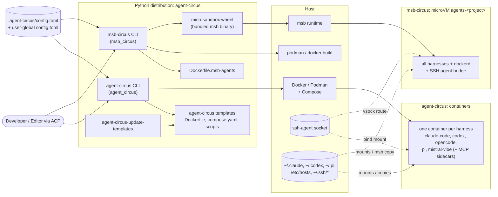
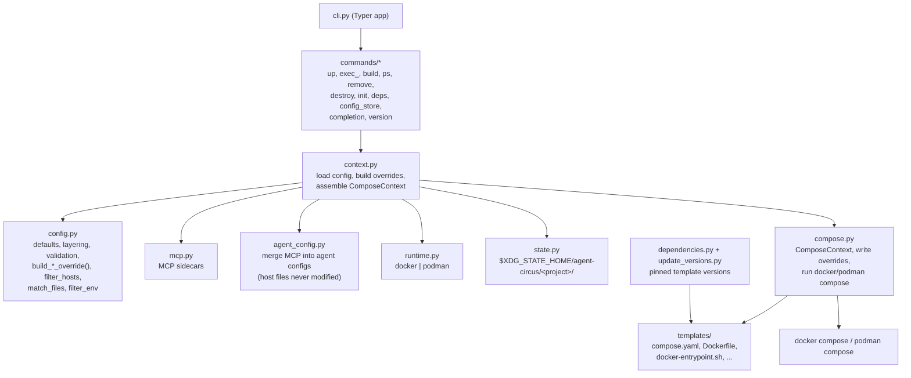
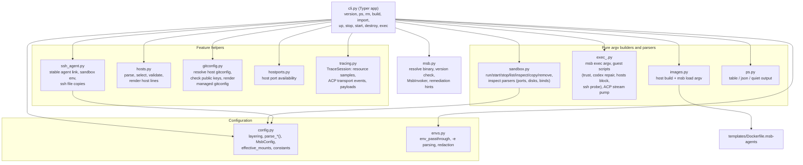
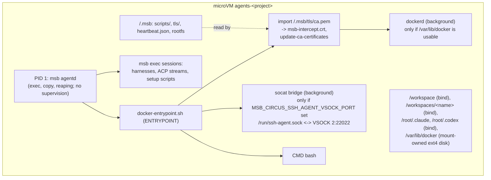
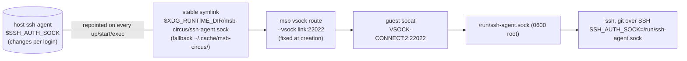
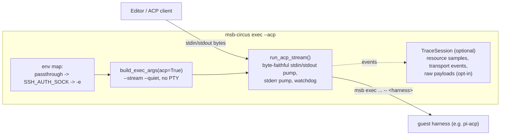

# Architecture

This document describes how the repository is structured, how the two
tools work internally, and what we learned while building them. It is
written for developers and coding agents that continue work on the
repository. User-facing documentation lives in `README.md` (agent-circus)
and `README.msb-circus.md` (msb-circus). Working rules for agents live in
`AGENTS.md`.

Last updated: 2026-11-08.

## 1. Purpose

The repository ships one Python distribution (`agent-circus`, see
`pyproject.toml`) with two independent CLIs that run AI coding-agent
harnesses (Claude Code, Codex, OpenCode, Pi, Mistral Vibe) in isolation:

| CLI | Isolation | Backend |
|---|---|---|
| `agent-circus` | One container per harness | Docker or Podman via Compose |
| `msb-circus` | One microVM per workspace, all harnesses inside | microsandbox (`msb` CLI, bundled in the `microsandbox` wheel) |

A third entry point, `agent-circus-update-templates`, refreshes pinned
tool versions in the bundled agent-circus templates.

Both CLIs read the **same** project config file,
`.agent-circus/config.toml`, plus a user-global layer at
`$XDG_CONFIG_HOME/agent-circus/config.toml`. Each tool interprets only the
keys it supports and ignores the rest (msb-circus logs ignored keys at
debug level). msb-circus-only settings live under `[msb]`.

## 2. Repository layout

```
src/
  agent_circus/          agent-circus CLI (Compose based)
    commands/            one module per CLI command
    templates/agent-circus/
                         Dockerfile, compose.yaml, entrypoint, hooks,
                         init-firewall.sh, install-ca-certs.sh, ...
  msb_circus/            msb-circus CLI (microsandbox based)
    templates/Dockerfile.msb-agents
  hatch_build.py         build hook: embeds the source commit
  microsandbox_sample.py untracked scratch file, not part of the product
tests/                   pytest suite for both tools (test_msb_circus_* for msb)
README.md                agent-circus user docs
README.msb-circus.md     msb-circus user docs
AGENTS.md / CLAUDE.md    agent working rules (CLAUDE.md includes AGENTS.md)
```

**Rule:** `msb_circus` never imports from `agent_circus`. Shared logic
(pattern matching, hosts parsing, env filtering) is re-implemented in
`msb_circus` on purpose (`envs.py`, `hosts.py`). Behavior must stay
aligned with agent-circus where the config table is shared.

## 3. High-level component view



## 4. agent-circus

### 4.1 Concepts

- **Services:** `AVAILABLE_SERVICES = ["claude-code", "codex",
  "mistral-vibe", "opencode", "pi"]` (`config.py`), one Compose service
  each, defined in `templates/agent-circus/compose.yaml`.
- **Modes:** *instant mode* (default) uses the bundled templates directly;
  *deploy mode* (`agent-circus init --deploy`) copies them into
  `.agent-circus/` for per-project customization. Deploy mode wins when
  present.
- **Runtime selection** (`runtime.py`): CLI `--runtime` >
  `AGENT_CIRCUS_RUNTIME` > `[runtime] engine` > `docker`.
- **Features as Compose overrides:** each config feature (`[ssh]`,
  `[git]`, `[hosts]`, `[ca_certs]`, `env_passthrough`, shadow files,
  additional dirs, data stores, port forwards, MCP, claude-mem, startup
  hook, ...) is turned into a small JSON Compose override file and passed
  with `-f`. Overrides are written to the per-workspace state directory
  `$XDG_STATE_HOME/agent-circus/<project>/` (`state.py`).
- **In-container setup** happens in `docker-entrypoint.sh` (copy SSH files
  from `/run/ssh-host/`, build `.gitconfig`, install CA certs from
  `/run/ca-host/` via sudo, codex daemon repair, hooks).

### 4.2 Internal view: from config to `docker compose`



## 5. msb-circus

### 5.1 Concepts

- **One sandbox per workspace**, named `agents-<sanitized project dir>`
  (`config.sandbox_name_for_workspace`). All harnesses run in it; the
  harness is chosen per `exec` (`[msb.agent] command`, default `pi`).
- **The guest runs as root.** Guest paths for user config are under
  `/root` (e.g. `/root/.claude`, `/root/.ssh`).
- **msb is driven only through its CLI.** Every msb call goes through
  `msb.MsbInvoker` with argv lists produced by **pure builders**
  (`sandbox.py`, `exec_.py`, `images.py`). Builders are unit-tested without
  msb; the CLI module wires them together.
- **msb binary resolution** (`msb.py`): `[msb] binary` > the binary
  bundled in the `microsandbox` wheel > `msb` on `PATH`. A version drift
  warning applies only to non-bundled binaries; the expected version is
  the installed `microsandbox` distribution (no hard-coded fallback).
- **Image:** `Dockerfile.msb-agents` (Debian slim Node base, uv,
  static dockerd from the dind image, apt packages incl. `openssh-client`
  and `socat`, agents pinned by version). Built on the host with podman
  (default) or docker, exported as tar, imported with `msb load`.
- **Boot path:** always `msb run --detach` (never `msb create`), because
  only `run` executes the image ENTRYPOINT.

### 5.2 Internal view: modules



### 5.3 Internal view: `up` / `exec` boot sequence

`_ensure_sandbox_running()` in `cli.py` is the core. `up` calls it
directly; `exec` calls it before running the command, so every `exec`
also refreshes host-derived state.

```mermaid
sequenceDiagram
    autonumber
    participant CLI as msb-circus (cli.py)
    participant Host as Host checks
    participant MSB as msb runtime
    participant Guest as Guest VM

    CLI->>Host: load + validate config, effective_mounts()
    CLI->>Host: [ssh] refresh_agent_link() (fatal if no SSH_AUTH_SOCK)
    CLI->>MSB: msb image inspect &lt;tag&gt; (build/import if missing and --build)
    CLI->>MSB: msb list --format json
    alt sandbox running
        Note over CLI,Guest: reuse
    else sandbox stopped
        CLI->>Host: fail if a forwarded host port is occupied
        CLI->>MSB: msb start &lt;name&gt;
    else no sandbox
        CLI->>Host: fail if a forwarded host port is occupied
        CLI->>MSB: msb run --detach --name ... --volume ... --port ...<br/>--vsock &lt;link&gt;:22022 --env ... --mount-owned/--root-disk ... &lt;image&gt;
        MSB->>Guest: boot, ENTRYPOINT docker-entrypoint.sh
    end
    CLI->>Guest: msb exec: pi trust.json
    CLI->>Guest: msb copy: agent config files (.claude.json, pi, opencode)
    CLI->>Guest: msb exec: rewrite managed /etc/hosts block ([hosts])
    CLI->>Guest: msb exec: Claude Code folder trust
    CLI->>Guest: msb exec: codex daemon symlink repair
    CLI->>Guest: msb copy: ~/.ssh/config, known_hosts ([ssh])
    CLI->>Guest: msb exec + msb copy: managed git config, host gitconfig, signing key ([git])
    CLI->>Guest: msb exec: ssh-add -l probe ([ssh], warn only)
    CLI->>MSB: msb inspect: drift warnings (config mounts, ports, disks, worktree mirror)
    CLI->>Guest: msb exec: docker info until ready (if docker enabled)
```

All per-boot guest steps are **best-effort**: failures log warnings and
never block the boot. Host-side validation errors are **fatal** before any
msb call.

### 5.4 Internal view: inside the guest



Notes:

- There is **no real init system** yet. Background services are children
  of the entrypoint shell; nothing restarts them. msb supports
  `--init auto|<path>` to hand PID 1 to systemd/s6/runit (agentd keeps
  running as a child). s6-overlay is the favored candidate; see §9.
- dockerd needs a real filesystem for `/var/lib/docker` (overlayfs on
  overlayfs fails). Docker is enabled by `[msb.sandbox] docker_disk`
  (`--mount-owned /var/lib/docker:kind=disk,size=...`) or a flat root
  (`root_disk = "flat:..."`). Otherwise the entrypoint prints an
  explanation and skips dockerd.
- Go programs (dockerd) cache the system cert pool per process, so CAs
  must be installed **before** dockerd starts.

### 5.5 Internal view: SSH agent forwarding



- Why: a socket file bind-mounted into a microVM does not carry
  connections; microsandbox has no agent forwarding (`msb ssh` does not
  support stream-local forwarding). vsock host-socket routes are the
  building block.
- Guest `SSH_AUTH_SOCK` is set as sandbox env at creation **and** injected
  into every `exec` env (after `env_passthrough`, before `-e`), so a host
  value leaking through a `SSH_*` passthrough glob cannot override it.
- Pending live checks: whether msb re-opens the host path per connection
  (symlink trick), and whether the entrypoint runs again on `msb start`.

### 5.6 Internal view: `exec` and ACP



In ACP mode, stdout carries only ACP bytes and warnings go to the log
file (`[logging] file`), never to stderr (ACP clients treat stderr as an
error channel). Fatal errors still print to stderr right before exit.

## 6. Feature matrix (shared config tables)

| Config | agent-circus | msb-circus | msb-circus mechanism | Refresh |
|---|---|---|---|---|
| `[[additional_dirs]]` | yes | yes | `--volume` at `/workspaces/<name>` | creation |
| `[[port_forwards]]` | yes | yes | `--port`; host port probe before boot | creation, drift warning |
| `env_passthrough` | yes | yes | `msb exec --env` per exec | every exec |
| `[git] worktree_mirror` | yes | yes | second bind mount at host abs path | creation, drift warning |
| other `[git]` keys | yes | no (debug-ignored) | - | - |
| `[ssh]` | yes | yes | vsock route + socat bridge + `msb copy` of config files | route: creation; files: every boot |
| `[hosts]` | yes | yes | managed block in guest `/etc/hosts` via `msb exec` | every up/start/exec |
| `[ca_certs]` | yes | **planned** | see §9 | - |
| agent config dirs | data stores / mounts | `/root/.claude`, `/root/.codex` bind mounts + file copies | mounts: creation; copies: every boot |
| `[msb.*]` | ignored | yes | image, sandbox (memory, cpus, disks), network mode, agent, tracing, mounts, env | mostly creation |
| `[logging]` | yes | yes | Python logging | - |

**General rule for msb-circus:** anything passed to `msb run` (mounts,
ports, vsock routes, sandbox env, disks, network) is fixed at creation.
Changing it needs `msb-circus rm -f && msb-circus up`; msb-circus warns via
`msb inspect` drift checks where the inspect schema is known. Anything
done via `msb copy` / `msb exec` after boot is refreshed on every
`up`/`start`/`exec` and needs no re-creation.

## 7. microsandbox facts we rely on

Docs: <https://docs.microsandbox.dev/llms.txt> (index) and `llms-full.txt`.
Bundled msb version: see `uv.lock` (0.7.13 at the time of writing).

- `--vsock HOST_UNIX_SOCKET:PORT` exposes a host Unix socket to the guest
  at host CID 2 (since v0.6.9; local backend only; port 123 reserved).
- `--trust-host-cas` (YAML `network.trust_host_cas`) copies **all**
  trusted host root CAs into the guest at start; off by default. Exact
  guest location is unknown (being investigated, §9).
- `--tls-intercept` makes msb's own inspection CA
  (`~/.microsandbox/tls/ca.{crt,key}`) available in the guest at
  `/.msb/tls/ca.pem`; the entrypoint imports it.
- Rootfs **patches** (`--copy-file`, `--mkdir`, YAML `patches`, incl.
  `append`) apply before the first boot only.
- DNS: msb intercepts DNS on the host; no static records. Guest
  `/etc/hosts` lookups bypass msb's DNS view, so domain-based net rules
  do not match those names (default mode `public,private` is IP based).
- `host.microsandbox.internal` reaches the host when the `host` network
  group is allowed.
- `--init auto|<path>` hands PID 1 to a real init; persisted across
  restarts for detached sandboxes.
- `msb ssh` / `msb ssh serve` give SSH access *into* a sandbox; not used.

## 8. Feature status (msb-circus)

The user verifies msb behavior on a real KVM host; this container has no
KVM, docker socket, or msb runtime.

| Feature | Status |
|---|---|
| Port forwarding, git worktree mirror, pi/Claude workspace trust | implemented |
| Docker data disk / flat root | implemented, pending live verification |
| Removal of the hard-coded fallback msb version | implemented (`641608a`) |
| SSH agent forwarding | implemented (`b0650bc`); open live checks: does msb re-open the symlinked host socket per connection, does the entrypoint run again on `msb start` |
| Host entries | implemented (`809068f`) |
| CA certificates (`[ca_certs]`) | in analysis, see §9 |
| Init system (s6-overlay) | idea |

## 9. Work in progress

### 9.1 CA certificates for msb-circus

Goal: port agent-circus `[ca_certs]` (`patterns`, `path`, default
`/usr/local/share/ca-certificates`; file-name matching like `[hosts]`).

Proposed design (not yet approved):

1. Same table and matching. Validate PEM content on the host; install
   every file as `<stem>.crt` (agent-circus silently ignores non-`.crt`).
2. On every boot/start/reuse: clear guest dir
   `/usr/local/share/ca-certificates/msb-circus/`, `msb copy` the selected
   files, run `update-ca-certificates` (one `msb exec`). Best-effort.
3. Entrypoint must run `update-ca-certificates` on every boot when that
   dir exists (before dockerd). First-boot gap: dockerd started before the
   copy; documented, or fixed later with a real init.
4. Open decisions: tool-specific trust env (`NODE_USE_SYSTEM_CA=1`,
   `REQUESTS_CA_BUNDLE`, uv native TLS; names to be verified), and an
   optional `[msb.network] trust_host_cas` passthrough.

**Live investigation in progress:** to see what `--trust-host-cas` puts
into the guest, `src/msb_circus/sandbox.py:build_run_args` currently
**always appends `--trust-host-cas`**. This change is marked `TEMPORARY`,
is **uncommitted**, and breaks three argv tests on purpose. Revert it
(`git checkout src/msb_circus/sandbox.py`) once the user reports the
guest listing of `/.msb/tls`, mounts, and the trust-store certificate
count. Without the flag, `/.msb/tls` is empty.

### 9.2 Init system

Considered: hand PID 1 to s6-overlay via `msb run --init auto` and move
dockerd and the SSH bridge into s6 services (conditional on env vars),
which adds restarts, ordering, and clean shutdown. Needs a live spike
first (detached boot, restart behavior, env propagation, `msb exec`).

## 10. Conventions and working rules

- Run everything through uv: `uv run pytest`, `uv run ruff check`,
  `uv run ruff format --check`, `uv run ty check`. All must pass before a
  commit.
- Commits: Conventional Commits with scope (`feat(msb-circus): ...`),
  imperative subject under 60 characters, exactly one short description
  paragraph, no AI or tool credit footers, **unsigned**
  (`uv run git commit --no-gpg-sign`; the user signs). One feature or fix
  per commit; stage only related files. See `AGENTS.md`.
- Docstrings in Sphinx style (`:param:`, `:returns:`, `:raises:`); type
  hints everywhere; call out shortcuts explicitly.
- Tests: `tests/test_<feature>_<scenario>.py`, functions
  `test_<action>_<expected_outcome>`. CLI tests patch `cli_module`
  (`MsbInvoker` -> `FakeInvoker`, `resolve_msb_binary`, `check_version`)
  and use `typer.testing.CliRunner`. The suite is isolated from the
  ambient user config.
- Guest shell scripts built in Python receive data as positional
  arguments (`sh -c SCRIPT sh ARG`), never by string interpolation. Test
  them by running the script locally against temp files.

## 11. Lessons learned

- `os.path.realpath()` on a symlink follows it. The SSH loop check
  compared `realpath(link)` and failed on every refresh after the first;
  compare with only the parent directory resolved (`_resolve_parent`).
- Shell `printf "%s" "$block"` drops nothing, but callers easily lose the
  trailing newline; let the guest script add it (`printf "%s\n"`),
  otherwise the end marker of the hosts block gets glued to the last
  entry.
- msb flags and JSON schemas change between releases (msb is beta).
  Parsers of `msb list`/`msb inspect` output are defensive and treat
  unknown shapes as "cannot verify" instead of reporting drift.
- Things that look like host paths inside copied config files (e.g.
  `IdentityFile`, `UseKeychain` in `~/.ssh/config`) may not work in a
  Linux guest; document instead of rewriting user files.
